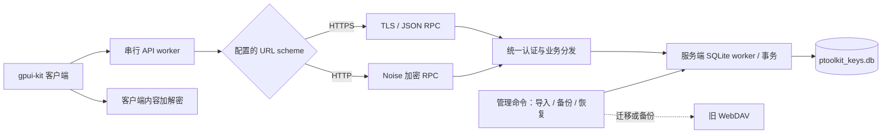

# 服务端改造 Roadmap

日期：2026-11-03。研究基线：`main`，提交 `dd06da7`。状态：P0、M0 已完成，M1–M5 软件功能已实施；M6 已完成本机合成迁移与功能验证，并已用真实旧库 `ptoolkit_keys.db` 在本机跑通 HTTP 与 HTTPS 端到端验证；独立部署、GUI 原生回归与故障注入仍待执行。实现、测试和原生 UI 证据见 [实施记录](server-implementation-validation.md)。备份、部署及跨平台交付按用户回复延后。

## 1. 目标与已确认边界

把当前的「桌面客户端通过 WebDAV 交换整份 SQLite」改为「服务端管理 SQLite，桌面客户端通过 API 操作条目」。客户端运行期间也不再创建、下载或序列化完整 SQLite 数据库。

本轮用户已确认，相关回复已记录到 `AGENTS.md` 的“补充”：

- 服务端直接持有 `ptoolkit_keys.db`；WebDAV 仅用于旧库迁移或备份，不参与日常请求。
- 条目内容继续由客户端加解密。内容加密口令、派生密钥及内容明文不发给服务端；服务端保存内容密文。
- HTTP 请求和响应增加应用层加密通道；HTTPS 使用 TLS，省去额外的应用层通道加密。两种模式都保留条目内容加密。
- HTTP 服务端生成身份公私钥；客户端首次由用户通过可信途径输入或导入服务端公钥。
- 初次任务只产出研究与 roadmap；现用户已授权从 M0 开始实施。原建议与 M0 回复冲突时，以 `AGENTS.md` M0 补充和 [v1 合同](m0-contract.md)为准。

新增已确认的前置要求：开始第一阶段 M0 之前，先将 UI 框架从 egui + glow 更换为 gpui-kit，并完成项目清理与构建目录体积控制（见 P0）。该前置要求现已授权实施，进展见下方 P0 记录。

继续保留：单库、Claude 配色、内置中文字体、描述与内容两列表格、按需查看、60 秒遮蔽及编辑冻结计时、双击编辑、右键复制、删除确认、底部状态栏、macOS 普通二进制与关闭窗口退出。

“所有操作走 API”指连接、认证、查询和数据修改等远程业务操作。复制、遮蔽、取消编辑等本地 UI 操作继续在客户端完成。

### M0 已确认的修订（2026-11-03）

- 单管理员、多客户端、强制登录，会话 48 小时；不保存登录密码。
- 普通条目修改采用后提交覆盖，按 SQL 成功提交顺序应用字段补丁；不因旧条目 revision 拒绝编辑。读取/分页仍检查 revision；世代、key epoch 及轮换整体基线检查仍保留。
- 临时断网保留配置，清除显示明文和编辑缓冲；查看行内加载，写入及结果未知全局遮罩，查询原 operation_id 恢复。
- 内容明文 32 KiB、描述 UTF-8 4 KiB、100,000 条、整个 RPC 明文 60 KiB；超限旧库明确阻止迁移，无分帧或截断。
- 本轮专注功能，可仅支持 macOS；备份和部署移出本轮，不要求 Linux、systemd、反向代理交付。下文备份/部署章节保留为未来设计，不构成本轮功能阶段退出条件。

具体协议、错误码、数据库草案、UI 状态表和 HTTP profile 见 [M0 合同](m0-contract.md)。下文仍标为“建议”的历史设计不能覆盖上述用户决定，尤其不沿用普通条目编辑的冲突拒绝。

## 2. 现状研究

### 2.1 模块与耦合位置

下列路径相对于仓库根目录，行号对应研究基线。

| 当前模块 | 已核实行为 | 改造方向 |
| --- | --- | --- |
| `Cargo.toml`、`src/main.rs` | 单个桌面二进制，尚无自建服务端；入口固定使用 glow | 保留桌面入口，增加独立服务端与共享协议库 |
| `src/db.rs:18` | 两张业务表：`meta(key,value)`、`entries(id,desc,content)`；使用内存 SQLite，支持整库反序列化/序列化 | 服务端文件 SQLite repository；客户端移除 `Db` |
| `src/crypto.rs:15` | Argon2id 派生 32 字节密钥；AES-256-GCM；存储为 `base64(12 字节随机 nonce || 密文及认证标签)` | 保留为客户端内容加密模块；不用于网络会话密钥 |
| `src/app.rs:197` | 新库建立随机盐及加密校验值 `ptoolkit-ok`；已有库在本地校验口令 | 改为取得库加密元数据后在客户端校验 |
| `src/webdav.rs:32` | 无认证 PROPFIND 检测登录；OpenList token 校验；WebDAV 使用 Basic | 日常客户端替换为自建 API；WebDAV 仅留在管理工具/备份适配器 |
| `src/webdav.rs:98` | GET 整库，PUT 临时库后 MOVE 覆盖主库；30 秒超时 | 改为条目请求、服务端 SQL 事务与操作结果查询 |
| `src/sync.rs:108` | 单个后台线程执行 blocking 请求；epoch 丢弃旧任务/旧结果 | 复用串行 worker 和 epoch 思路，命令从下载/上传变成业务 DTO |
| `src/app.rs:565` | `App` 同时持有 `Db`、条目密文副本、派生密钥、明文、编辑状态及同步状态 | 拆分 UI、API 状态与内容加密；列表只缓存 UI 所需数据 |
| `src/app.rs:760` | 主页有焦点时每 2 秒下载整库、比较 SHA-256 | 改为查询逻辑 revision，有变化再拉条目元数据 |
| `src/app.rs:907` | 客户端复制整库、逐条重加密，上传成功后才提交新口令 | 改为分批密文轮换与服务端一次原子提交 |
| `src/app.rs:1065` | 先修改内存 DB/UI，再整库上传；失败后恢复服务端版本或上传本地库修复 | 改为待提交状态、服务端确认与幂等恢复 |
| `src/config.rs:9` | 保存服务地址、内容口令、OpenList 账号、密码、token；Unix 目录 700 / 文件 600 | 配置版本化，加入 HTTP 公钥，迁移旧凭据，保存新服务会话 |

关键判断：这是数据所有权和失败恢复机制的改造，不能只把 `webdav::download/upload_atomic` 换成两个 HTTP 接口。

### 2.2 原规则中必须替换的部分

| 旧规则 | 新架构建议 |
| --- | --- |
| 启动下载 SQLite；每次修改整库覆盖 | 登录后拉加密元数据/列表；按条目读取和修改 |
| 每 2 秒下载并比较文件摘要 | 每 2 秒查询 `vault_revision`；相同则无提示、无列表刷新 |
| MOVE 响应丢失后重新下载，尝试旧/新口令 | 用持久化 `operation_id` 查询提交结果，再核验 `key_epoch` 与 verifier |
| 404/损坏库可由客户端新建或覆盖修复 | 服务端初始化、健康检测、备份恢复负责；客户端不得据此覆盖数据 |
| 多客户端整库后上传覆盖 | 按用户确认采用字段补丁与后提交覆盖，不用旧条目 revision 拒绝普通编辑 |
| OpenList token + Basic 账密 | 新服务端认证与会话，不把 OpenList 凭据作为新 API 凭据 |
| 任意同步网络失败清空口令及账密 | M0 已确认临时断网保留配置并清理明文；会话失效回登录、口令不符回向导，库不可用停止写入 |

运行中库文件被删除或损坏时，不再执行旧版的自动新建/覆盖修复。服务端应停止写入并返回库不可用，管理员从备份恢复；明确初始化命令才可创建新库。

### 2.3 已完成的基线验证

- `cargo test --locked`：7 passed，0 failed，覆盖 SQLite 往返、口令校验、损坏库分类、摘要及恢复决策。
- 编译有 `xcrun` / `DVTFilePathFSEvents` 环境警告，测试仍成功结束。
- 当前没有网络协议、真实 WebDAV 故障、多客户端竞争或 UI 自动化测试。
- 本轮未读取 `.env` 中的凭据，未连接或修改测试 WebDAV，未操作真实密钥库和用户配置。现有测试通过不代表新服务端/安全协议已验证。

## 3. 建议架构与工程拆分



建议采用 Rust workspace，保留现有 `src/` 桌面程序，减少无关文件搬迁：

```text
Cargo.toml                       # root package + workspace
src/
  app.rs                         # UI 与界面动作
  config.rs                      # 客户端配置及旧配置迁移
  crypto.rs                      # 仅条目内容加密
  api.rs                         # 类型化 API client
  sync.rs                        # 串行命令/事件、epoch、重试协调
crates/
  protocol/src/                  # DTO、操作枚举、错误码、版本约定
  transport/src/                 # Noise profile、会话封装；不依赖 GUI/SQLite
  server/src/                    # HTTP 入口、认证、业务、文件 SQLite、管理命令
docs/
  server-migration-roadmap.md
```

服务端建议使用 `axum + tokio` 接收 HTTP，沿用 `rusqlite`。SQLite 连接交给专用线程，通过有界消息队列处理命令；不在异步 handler 中直接运行阻塞 SQL。首版单进程、单库、单数据库 worker，事务内串行化写入。`axum` 的路由/状态/中间件能力可支持此拆分。[S5]

桌面端继续使用现有 blocking reqwest + worker，无需为此次改造强制换异步 UI。服务端独立构建，不拉入字体、gpui-kit 或其他 GUI 依赖。新增依赖在实施时核验兼容性、许可证与 Rust 版本，再锁入 `Cargo.lock`；本 roadmap 不要求升级现有依赖。

## 4. 两层加密与 HTTP 安全通道

### 4.1 密钥和数据职责

| 对象 | 生成/持有方 | 用途与约束 |
| --- | --- | --- |
| 内容口令与派生密钥 | 客户端 | AES-GCM 加解密条目；不出现在 API、服务端日志或管理配置中 |
| 内容 salt、KDF 参数、verifier、`key_epoch` | 服务端保存，客户端读取 | 本地派生、校验和识别轮换版本；不是网络身份认证 |
| HTTP 服务身份私钥 | 服务端 | 认证加密通道的服务端身份；独立文件、限制权限、稳定保存 |
| HTTP 服务身份公钥 | 客户端可信导入并按服务地址保存 | 公钥不是秘密，但导入来源必须可信；不能在同一条未认证 HTTP 连接上下载后自动信任 |
| 临时通道密钥 | 双端仅在内存 | 握手派生，双向独立状态；不复用内容密钥，不持久化 nonce 状态 |
| 登录密码与会话 token | 新服务端认证体系 | 密码只在受保护请求内传输；服务端保存密码哈希及 token 摘要 |

HTTPS 的“无需额外加密”只取消 HTTP 专用通道封装。发送/返回的条目内容依然是内容密文；描述在数据库中仍为明文，网络中由 TLS 或 Noise 保护。服务端因此能看到描述、条目数量和访问行为，不承诺隐藏全部元数据。

### 4.2 HTTP 推荐方案：Noise，而非自创握手

建议采用 `snow` 实现固定 profile `Noise_NK_25519_ChaChaPoly_SHA256`。NK 与已确认的“客户端预先知道服务端公钥”相匹配；Noise 定义握手、密钥派生和认证加密，`snow` 提供握手及传输状态接口。[S1][S2]

该选型已在 M2 实施并完成本机原型验证，覆盖范围见实施记录；不声称“使用 Noise 就自动保证应用协议安全”。HTTP 适配、业务鉴权、重试和资源限制由项目实现。

建议连接流程：

1. 根据用户配置的 URL 确定模式。HTTP 必须存在可信导入的服务端公钥；缺失时停在配置界面。
2. `POST /api/v1/channel/handshake` 传递 NK 握手消息，完成服务端身份认证与通道密钥建立。握手期间不发送密码、token、条目或其他业务数据。
3. 握手的 prologue 固定绑定协议版本、规范化服务地址/基础路径、通道模式。服务端显式配置对外基础地址，不从任意代理头推断。服务端身份由预置公钥校验；认证后的响应提供 `server_id`、`vault_id`。
4. 握手完成后，`POST /api/v1/channel/message` 发送一个 Noise 传输消息，响应也是一个 Noise 传输消息。加密体内包含操作、参数、token、请求编号；token 不放在明文 HTTP header、URL 或 cookie 中。
5. 登录错误、权限错误和业务失败也放在认证加密的响应体中。网关错误、断线和握手前错误只能视为通道失败，不作为“写入成功”“需要降级”等业务结论。

必须约定并测试：

- 双向加密并校验认证标签，响应绑定 `request_id`；拒绝篡改、重放、错方向、错会话和错协议版本消息。
- 每个客户端会话至多一个在途请求。由库维护各方向计数器，不自行重置 nonce，不改用无状态计数器绕过顺序校验。
- 通道超时、响应丢失、计数器失步或服务重启后，销毁旧通道并重新握手；不盲目重发旧密文。业务重试使用原 `operation_id`、新 `request_id`，与通道防重放分开处理。
- 服务端为每个通道独占处理状态，限制未认证握手数量、通道总数、空闲时长、请求大小与队列长度；空闲/寿命到期后重新握手。
- HTTP 外层只暴露固定路径、随机通道定位标识及必要 framing；业务参数不写进 URL。通道标识不是认证凭据。
- `snow` 单个 Noise 消息最多 65,535 字节；首版建议加密前整个 RPC payload 限制为 60 KiB，预留封装空间，列表与轮换分批处理。M0 已确认内容明文上限 32 KiB、描述上限 4 KiB，超限迁移明确拒绝，首版不做分帧或截断。[S2]
- 首版固定密码套件，无由网络控制的“关闭加密”或套件降级协商。应用层加密不隐藏目标地址、流量大小/时序，也不能阻止阻断服务。

服务端公钥更换必须重新通过可信途径导入；不能遇到不匹配就接受网络返回的新公钥。切换服务地址时，不自动复用旧地址的公钥和认证会话。

### 4.3 HTTPS 与部署入口

HTTPS 直接发送同一份 RPC DTO，不使用 Noise 信封；保留证书链与服务身份校验。自签名部署通过明确配置可信 CA 解决，不提供“忽略证书错误后继续”的默认路径。[S6]

建议分开部署入口：

- **公网 HTTP 入口**：只接收 Noise 握手和密文消息；拒绝明文业务 RPC，包括明文登录。
- **HTTPS 入口**：直接 TLS，或受信任的 TLS 反向代理转发到私有 JSON RPC listener。
- **代理后端 listener**：仅本机/受控私网可达；跨不可信网络的代理后端也要 TLS。不能仅凭客户端可伪造的 `X-Forwarded-Proto: https` 放行明文 RPC。

客户端建议 `redirect::Policy::none()`，要求用户显式修改地址；禁止自动跨 origin 转发密码/token、HTTPS 降为 HTTP，以及加密失败后自动明文重试。现有 reqwest 默认会跟随重定向，新 API client 需显式覆盖。[S7]

## 5. API、认证与服务端数据模型建议

### 5.1 业务协议

用统一的类型化 RPC 分发，HTTPS 的 `POST /api/v1/rpc` 与 HTTP 加密通道共用业务函数，避免维护两套业务行为。公网 HTTP listener 不开放明文 `/rpc`。

请求基础字段建议：`protocol_version`、`request_id`、`operation`、`session_token`、`args`；写操作另外要求 `operation_id`、当前数据世代、相关 revision 和 `key_epoch`。响应回显 `request_id`，返回明确的结果/业务错误和相关版本号。所有业务响应禁用缓存，日志只记录操作类型、编号、耗时及非敏感错误码。

| 操作 | 主要输入/结果 | 关键规则 |
| --- | --- | --- |
| `server.info` | 协议版本、服务身份、是否已初始化 | 建立可信通道后调用，不泄露账号/条目 |
| `auth.login` / `auth.validate` / `auth.logout` | 账密换 token、验证/撤销会话 | HTTP 登录及自动登录同样必须加密 |
| `vault.initialize` | 初始 salt、KDF 参数、verifier | 显式授权初始化；只能从未初始化状态成功一次 |
| `vault.meta` | `vault_id`、数据世代、`vault_revision`、`key_epoch`、KDF、salt、verifier | 客户端本地校验内容口令；不能把口令发给服务端验证；先校验首版固定 KDF 参数，避免非法资源开销 |
| `entries.list` | 仅 ID、描述、条目 revision、key epoch；分页 | 不返回整库文件，也不批量预取内容 |
| `entries.read_content` | 指定 ID 和预期条目 revision，返回内容密文 | 点击查看时获取；返回版本不符则刷新，避免描述与内容来自不同版本 |
| `entries.create` | 描述、内容密文、当前 key epoch | 返回服务端分配 ID 与 revision；新增空内容也须由客户端加密 |
| `entries.update` | ID、字段补丁、当前 key epoch | 只更新指定字段；按事务成功提交顺序后提交覆盖 |
| `entries.delete` | ID、当前 key epoch | 沿用 UI 二次确认；重复请求不重复执行 |
| `operations.get` | `operation_id` | 断线/响应丢失后查询真实提交结果 |
| `rotation.begin/read_batch/stage/commit/abort/status` | 轮换批次、基线版本、新加密元数据及密文 | 详见第 7 节；不接收旧/新内容口令 |

业务错误至少区分：未认证、会话过期、权限不足、条目不存在、版本冲突、key epoch 变化、库未初始化/不可用、参数非法、限流、操作记录过期、暂时不可达。HTTP 通道的外层状态码不代替已认证的业务结果。

### 5.2 首版认证范围

建议单库、单管理员账号、允许多个桌面客户端登录；不做注册、角色管理、租户或 OpenList 联邦登录。已在 M0 确认。

- 服务端管理命令建立管理员账号；不提供默认口令或未认证的公网初始化接口。
- 登录密码采用独立盐的 Argon2id 密码哈希，记录参数；与内容密钥派生相互独立。现有 Argon2 库同时提供密码哈希与密钥派生接口。[S9]
- 使用高熵随机不透明 token，服务端只存摘要，设到期时间并支持撤销。建议首版到期重新登录，不再额外引入 refresh token 流程；有效期已在 M0 确认为 48 小时。
- 客户端保存 token、可选用户名；新流程不再需要为 Basic 保存账号密码。M0 已确认不保存登录密码。
- 能完成 Noise 握手只证明对端服务身份，不表示客户端已获条目访问权限；每项业务仍检查登录和授权。

### 5.3 SQLite 模型与事务

服务端建议仍用一个 `ptoolkit_keys.db` 保存业务和认证状态，新增内容如下：

| 表/数据 | 作用 |
| --- | --- |
| `schema_migrations` 或 `user_version` | 明确 schema 版本，拒绝不支持的较新版本 |
| `vault_meta` | vault ID、数据世代、整体 revision、key epoch、内容格式、KDF 参数、salt、verifier、初始化状态 |
| `entries` | 保留旧 ID/描述/内容密文；增加条目 revision 与必要的版本字段 |
| `users`、`sessions` | 管理员密码哈希、会话摘要、到期/撤销信息 |
| `operation_results` | 操作 ID、主体、请求摘要、结果、提交版本、保留时间 |
| `rotation_jobs`、`rotation_entries` | 轮换基线和暂存密文；正式提交前不改变当前内容 |

每个写操作在同一个 SQL 事务内完成：验证会话和权限 → 检查同主体的操作记录 → 对新操作验证版本 → 修改指定数据 → 递增相关 revision → 写入操作结果 → commit。只有 commit 成功才返回成功；SQLite 的事务为这一原子边界提供基础。[S3] 轮换暂存等非正式条目修改不递增业务库 revision。

相同 `operation_id` 且主体/请求相同，应先返回已记录结果，不因这次操作自己推进了 revision/key epoch 而拒绝重试；同编号不同参数必须拒绝。请求摘要采用规范化的业务操作、参数及预期版本，排除会变化的通道标识、token 和 `request_id`，使重新登录后仍能查询/重试同一操作。认证、key epoch 和 revision 的检测不能与提交分离，以免并发请求越过检查。

操作结果正文的保留期与客户端允许重试窗口一并固定；正文过期后保留已使用编号的摘要/墓碑，拒绝重新执行，并返回结果已过期。不能仅删除所有记录，再把无法确定结果的请求当成全新写入自动执行。

首版建议 rollback journal / `synchronous=FULL`，保持一个主数据库文件。事务运行时 SQLite 可能产生 `-journal` 等辅助文件，“单库”不等于运行过程中绝不出现辅助文件；不为隐藏辅助文件关闭可靠日志。[S3] 若以后改 WAL，须同步更新备份、恢复和部署说明。

服务端数据目录与客户端配置目录分离，例如可配置的 `./data/ptoolkit_keys.db`；Unix 目录 700 / 文件 600。服务身份私钥独立于数据库保存；备份库文件不等于备份全部部署身份。

客户端配置继续位于 `~/.rust-keyrotation/config.json`，增加 `config_version`、按规范化服务地址保存的公钥和新服务会话字段。旧 `/dav/` 地址必须由用户显式改为新 API 基础地址；不自动把旧 OpenList token/密码发送给新服务。内容口令只在本地保留并重新校验，旧凭据迁移时清理；地址和端口保持双向同步。URL 拒绝内嵌账密和 fragment，公钥与会话不跨服务地址复用。

## 6. 客户端交互、轮询与失败恢复

### 6.1 查询与修改

- 连接：加载配置 → 选择 HTTPS/HTTP 通道 → 验证/手动登录 → 拉 `vault.meta` 本地校验内容口令 → 拉描述列表。
- 查看：点击 `*` 后发出该条 `read_content`；成功后才本地解密并开始独立 60 秒计时。重复点击合并请求，加载期间不给空明文或旧明文。
- 编辑：描述双击进入编辑；内容仅在查看成功后进入编辑/复制；Enter 提交一项 API 修改。UI 可立即显示待保存值，但未确认前必须标记待提交，不能提示成功；失败采用明确的恢复/冲突流程。
- 新增：客户端先生成空内容密文，请求成功取得 ID 后进入描述编辑；请求响应丢失不产生重复空行。
- 删除：保留原确认文字与按钮；提交成功才最终移除，版本冲突显示冲突原因。
- 内容改动：服务端确认后显示本次明文并刷新 60 秒计时；取消编辑继续剩余计时。退出/换地址/内容轮换/远端版本变化时清理明文、编辑与对话框。

移除 `App.db`、整库字节、`to_bytes/from_bytes` 日常路径、文件 SHA-256 比较及客户端修库逻辑。内容密文只在查看请求或轮换批次内短暂存在；数据库仍不落客户端磁盘，也不生成离线库。

敏感缓冲建议使用 `zeroize` 等尽力清理并减少 `String` clone；现有 `revealed.retain` 丢弃字符串不等于主动擦除内存。要同时审查编辑缓冲和 UI 复制产生的副本，不宣称可以保证清除操作系统、渲染器或剪贴板保留的所有副本。[S10] 不新增“60 秒后清空用户剪贴板”的业务行为。

### 6.2 自动同步和冲突

保留主页有焦点时每 2 秒轮询，但只请求 `vault_revision/key_epoch`。无变化不提示；变化后拉取新的描述列表。分页列表必须属于同一 revision：传入预期 revision，过程中有修改即重试，禁止把多个时间点的分页拼成一个已确认快照。

已保留远端变化后的查看/编辑/对话框清理、应用快照至少 500ms 遮罩和右侧持久提示。普通轮询不遮罩；M0 已确认查看为行内加载，写入和结果未知为全局遮罩。

M0 已确认写入与轮询竞争：Enter 提交后延后应用旧轮询结果，先处理写结果；普通字段修改采用后提交覆盖，不检查旧条目 revision。描述和内容只修改指定字段，不覆盖其他字段或其他条目；数据世代、key epoch 和轮换基线校验仍保留。

### 6.3 结果未知与重置

超时不等于失败，也不等于事务没有提交。建议状态为 `Submitting → ResolvingOperation → Confirmed / Rejected / Unreachable`：

1. 写请求未收到可信结果：保留原操作编号，阻塞依赖该结果的后续修改。
2. 必要时重建通道、恢复登录，查询 `operations.get`。
3. 已提交则取确认结果/最新版本；未提交且仍在重试窗口内可用原编号重试；无法确定时提示结果未知，不生成新编号盲目重做。
4. epoch 只能丢弃旧 UI 结果，不能撤销服务端已收到的写入。换地址、退出或关闭窗口时也遵守这一事实；下一次进入同一服务以服务端 revision 为准。

M0 已确认临时网络错误保留配置、清理明文并进入重试状态；会话失效回登录，内容口令不匹配回向导。新 API 客户端不沿用旧版网络错误清空全部秘密的规则。显式退出登录仍清空本地 token 与内容口令；尽力撤销服务端 token，离线时不把撤销未完成报告为已撤销。

## 7. 内容密钥轮换

继续满足“用旧密钥解密全部条目，用新密钥重加密；成功后才提交新口令”，但不传 SQLite，也不把新旧口令发给服务端。

建议流程：

1. 客户端清理全部明文/编辑状态，以当前 `vault_revision/key_epoch` 创建 `rotation_job`；服务端记录基线、条目集合和旧元数据。
2. 分批取得该基线的内容密文，在客户端逐条解密、用新 salt/KDF 派生的新密钥重新加密，再分批暂存新密文及新 verifier；单次 RPC 不超过通道限额，明文逐条处理后清理。
3. 首版不维护历史快照：每批读取和最终提交都要求当前 vault revision 仍等于基线；任何其他修改都会让轮换返回冲突并中止，重做时重新开始。暂存期间正式库仍为完整旧版本。
4. 提交时，服务端在一个事务中校验条目 ID 集合和数量、批次完整性、基线版本及新格式，再替换全部内容和加密元数据、递增 `key_epoch/vault_revision`、记录操作结果。服务端只能验证结构和完整性，不能验证自己无法解密的内容是否确实可用。
5. 客户端收到成功或查询确认后，才更新本地派生密钥、内容口令和配置。提交冲突/明确失败则保留旧口令；旧 key epoch 的客户端写入必须被服务端拒绝。
6. 提交响应丢失：按操作结果与 `key_epoch` 判断，客户端再校验对应 verifier；不恢复旧式整库下载或旧/新库覆盖。
7. 未提交批次支持主动取消、TTL 清理和服务重启后的状态查询；正式库必须始终是全部旧版本或全部新版本，不能混用密钥。

崩溃边界必须说明：服务端提交成功但客户端尚未保存新口令时进程退出，下次启动可能只剩旧口令。建议不额外持久化待提交的新口令，重新进入向导提示输入用户刚设置的新口令；不能承诺没有保存的新口令可以自动恢复。重连后 verifier 决定本地口令是否匹配。

首版保留现有内容密文格式并增加显式 `content_format=1` 和 KDF 参数，锁定旧版参数的兼容测试。绑定条目 ID 的 AAD、新密文格式、用随机数据密钥包裹实现快速换口令等作为后续独立设计，不与本次服务端迁移捆绑。

## 8. 旧库迁移、备份与回退

### 8.1 一次性迁移

1. 停止旧客户端写入，保留原 WebDAV 库与旧配置的受限权限备份；记录源库摘要。不能同时运行两个写入口。此处的旧客户端指用户环境中仍在运行的历史版本，本仓库自 2026-11-10 起不再包含其代码。
2. 由服务端管理工具或管理员取得一次旧 `ptoolkit_keys.db` 快照。允许迁移工具整库读取，但桌面新客户端的日常 API 不提供下载数据库功能。
3. 以只读方式验证源库：SQLite 完整性、期望表/字段、盐和 verifier 格式、条目 ID/类型/密文结构；不先调用现有会自动 `CREATE TABLE IF NOT EXISTS` 的 `Db::from_bytes` 来认定结构有效。[S8]
4. 在新服务端建立目标 schema，保留全部条目 ID、描述、密文、salt、verifier；补上明确的旧格式/KDF 参数及初始 revision。导入事务失败不得覆盖已有目标库。
5. 服务端没有内容口令，只能做结构验证；由新客户端或本地离线校验工具验证口令和全部条目的可解密性。真实口令通过交互或受控输入提供，不写在命令行参数、日志或 fixture 中。
6. 两端核对条目数量、ID、密文、描述和来源摘要；用新客户端验证查看/编辑/新增/删除及一次轮换后再切换使用。原库按约定保留为回退源，不自动删除。

旧 OpenList 测试环境的 `.env`（`TEST_SERVER`、`TEST_ACCOUNT`、`TEST_PASSWORD`）不能作为新服务端地址与管理员凭据。仓库已不再提供 `.env.example` 模板，也没有代码读取这些变量；新服务的入口是 `--data-dir` 加 `init` / `import` / `reset-password` 的 `--password-stdin`，客户端入口是 `~/.rust-keyrotation/config.json` 的 v2 配置，真实值始终不提交。

旧 WebDAV 若只有 HTTP，其 Basic 认证和明文描述不会因为新服务支持 Noise 就自动受保护。迁移/备份的 WebDAV 链路必须使用 HTTPS、可信本机链路或已有安全隧道；不让新客户端为了迁移自动回到 HTTP Basic。

### 8.2 新服务端备份与回退

- 默认做受限权限的本地备份；WebDAV 备份适配器可在后续阶段启用，不放进日常写事务关键路径。
- 在线备份使用 SQLite backup API 或经验证的一致性快照方式，不直接复制仍在写的主文件；SQLite 官方提供在线快照备份能力。[S4]
- 备份包含仍为明文的描述，以及认证哈希/会话状态等，须控制访问。恢复后撤销会话并重新建立通道；同时核查独立保存的服务身份私钥。
- 恢复生成新的服务数据世代标识，纳入客户端快照和写请求校验；不能因为备份中的 revision 数字恰好与客户端相同，就继续接受恢复前的旧写入/操作编号。
- 回退时先停新服务写入。原旧库只包含切换前的数据；若要保留切换后的修改，需要受控导出旧格式业务库（仅旧 `meta/entries` 与兼容内容格式），核验后交给历史版本的旧客户端使用——该客户端已不在本仓库，回退需要先取回对应发布物。不能直接把新版带认证表的库放回旧 WebDAV。
- 备份不是覆盖修复指令：库损坏先保留现场、停止写入，再执行明确的恢复步骤。

## 9. 分阶段实施与退出条件

阶段按依赖推进，不按未经验证的工期承诺推进。每阶段完成对应检查后才进入下一阶段；P0、M0 已完成，M1–M5 功能已实施，M6 本机合成验证与真实旧库端到端验证已执行。具体验收覆盖及剩余项目见 [实施记录](server-implementation-validation.md)，不把编译或组件测试当作完整真实环境验收。备份、部署和跨平台交付延后。

### P0：UI 框架迁移与项目清理（M0 前置）（已完成）

已确认要求：在开始 M0 及后续服务端改造之前，先将桌面 UI 从 egui + glow 更换为 gpui-kit，并对项目执行清理，避免构建目录持续膨胀。

交付：用 gpui-kit 重建向导、登录、主页表格、编辑框、确认对话框、遮罩和状态栏；移除不再使用的 egui/glow 依赖、旧 UI 代码与废弃资源，更新依赖锁文件及构建说明。此阶段继续沿用现有 WebDAV、内存 SQLite、加解密及同步业务规则。

清理要求（按用户澄清修订）：移除旧框架的废弃依赖、代码和资源，更新锁文件；构建产物只清理已确认属于旧依赖的部分。日常使用标准 Cargo 工作流，保留 `target/` 中仍在使用的依赖产物与增量缓存；不得在每次修改或测试后例行执行 `cargo clean`，不通过 `dist/` 接管用户构建，不为清理关闭开发和测试的默认增量编译。保留用户配置、`.env`、密钥库、源码和必要资源。

验收：gpui-kit 客户端可构建、启动，既定查看/编辑/复制/计时/同步/登录行为回归通过；中文字体、Claude 配色和 macOS 关闭窗口退出保持可用；构建说明与依赖一致，无遗留 egui/glow 运行路径；记录清理后以及一次必要构建后的目录占用，确认没有重复或废弃产物堆积。完成这些检查后才进入 M0。

P0 执行记录（2026-11-03，进入 M0 之前的历史记录）：

- 已用 gpui-kit 0.8.1 替换 egui/eframe；业务状态与 UI 拆分为 `src/app.rs` 和 `src/ui.rs`，同步 worker 不再依赖 UI 框架；WebDAV、内存库及加密业务保留。
- 已移除旧 UI 依赖与代码。此前错误地关闭了开发/测试调试信息和增量缓存，现已撤销并恢复 Cargo 默认设置。macOS 平台依赖的三处不稳定 API 采用保留许可证的本地兼容补丁，见 `vendor/gpui-pre-macos/PATCH.md`。
- 本机 Rust stable 1.96.0：格式检查、`cargo clippy --locked --all-targets -- -D warnings`、`cargo test --locked`（10 passed）和普通二进制构建通过。新增 GPUI 测试覆盖真实输入/鼠标事件、Enter/Esc、复制前置条件、到期遮蔽和替换库后的明文状态清理。
- 已启动使用空配置的临时原生预览，未读取用户配置或连接真实服务器；电脑控制工具拒绝访问该预览窗口，无法核对截图或通过点击验证关闭即退出。预览进程已停止，临时预览代码不保留在产品中。
- 后续已修复 hover 重绘延迟与 Cmd+Q，完成主页中文、高亮切换和 Cmd+Q 原生验证；完整测试增至 12 项。详细结果及本地配置误写事故见 `docs/ui-migration-validation.md`。
- 尚待验收：完整原生布局、真实窗口焦点/关闭交互、Windows 构建，以及真实 WebDAV 环境的完整 UI 回归。这些是当时保留的未验项；当前新 API 的验证覆盖、退役 WebDAV 与本轮平台范围以实施记录为准。
- 清理数据与可运行产物位置见 `docs/ui-migration-validation.md`。

### M0：冻结业务与协议约定（已完成）

交付：补齐 `AGENTS.md` 决策；协议/错误码、数据库草案、UI 状态迁移表、HTTP profile 与部署入口约定。

原待确认点（均已获得回复，具体决定见本页 M0 修订、AGENTS.md 和 [合同](m0-contract.md)）：

- 首版是否采用单管理员、多客户端、强制登录；会话有效期及是否取消保存登录密码。
- 是否接受条目版本冲突提示，替换旧版“后提交覆盖”；描述和内容同时改动是否算同一条目冲突。
- 临时断网是否保留配置；手动查看/写入的遮罩范围、失败提示及结果未知状态。
- 单条内容、描述、总条目数量和轮换批次的上限；超限旧条目迁移时应支持分帧还是明确阻止切换。
- 首版是否需要自动 WebDAV 备份，还是先交付本地备份；新服务端目标系统和部署方式。

退出条件：已确认的范围与方案建议区分清楚；业务疑问有用户回复并写回补充；没有把旧版冲突规则默默搬进新架构。

执行记录：五组业务问题逐项回复并写回补充；合同覆盖协议/错误码、持久层模型、UI 状态、HTTP profile 及 HTTPS 入口隔离。采用用户明确选择的后提交覆盖，读取一致性和密钥轮换的安全版本检查单独保留。当前客户端基线格式检查及 12 项测试通过；尚不能据此声称新服务端或新协议已通过验证。

### M1：workspace、协议和服务端持久层（功能已实施）

交付：共享 DTO/错误码；独立 server 构建；文件 SQLite、schema 版本、专用 DB worker、显式初始化、管理员管理命令、结构导入。备份按 M0 回复延后。

验收：服务重启后数据可读；缺失/损坏库不自动覆盖；条目事务与 revision 原子更新；导入不会改变源库；服务端依赖无 GUI。桌面端在 M4 前仍能按原方式构建；切换后的数据库/同步测试由新协议、服务端持久层与真实本机 API 测试承接，原 GPUI 交互测试保留。

### M2：双模式安全通道原型（功能已实施）

交付：可信公钥导入、Noise NK over HTTP、HTTPS JSON 入口、统一 dispatch 边界、监听器隔离、会话上限/超时、禁重定向和模式校验。

验收：两模式走同一组非敏感示例 RPC；公钥错误、篡改、重放、乱序、假服务端、通道过期/重启、明文绕过和 HTTPS 降级均被拒绝；HTTP 请求/响应抓包不出现测试秘密。本阶段尚不能因协议库可运行就判定全部业务安全。

### M3：认证、条目 API 与提交结果恢复（功能已实施）

交付：新管理员登录、token 验证/退出；meta/分页列表/内容按需读取/CRUD；revision/key epoch 检查；持久化操作结果及过期语义。

验收：HTTP/HTTPS 跑同一 API 合同测试；未认证无条目访问；重复新增不产生多行；同编号不同参数拒绝；事务失败全部回滚；提交后丢响应、服务重启后查询能定位真实结果；两个客户端不同条目修改均保留，同字段以后成功提交者覆盖，同条目的不同字段只改指定字段；旧 epoch 写入拒绝。

### M4：桌面客户端切换到 API（功能已实施）

交付：配置版本迁移、服务地址/HTTP 公钥配置、登录、列表、按需查看、CRUD、revision 轮询、异步状态映射；删除正常运行路径中的内存 SQLite 与 WebDAV 调用。

后续清理（2026-11-10）：v1→v2 配置迁移兼容层与 `legacy_endpoint` 字段一并删除，配置只接受版本 2，v1 文件直接报错并保持不动；仓库删除 `.env.example`。切换阶段的"配置版本迁移"因此只剩单向拒绝旧版本，不再读取或复用旧 WebDAV 凭据。

验收：保留全部既定表格/计时/编辑/复制/删除/状态栏行为；后台不下载 DB；分页变化不拼错快照；返回旧 epoch 的结果不污染新界面；临时断网、过期 token、错误内容口令、库不可用有区分；macOS 退出与 Windows 构建可验证。

### M5：事务化内容轮换（功能已实施）

交付：轮换任务、批次暂存、CAS 提交、客户端逐批重加密与确认后配置提交。

验收：空库/多批次/多语言内容兼容；错误旧口令不提交；并发修改使轮换冲突；旧 epoch 写入拒绝；任意批次失败不污染正式库；最终提交前后强杀、丢响应/重启都不会产生半新半旧数据；提交后客户端崩溃可通过重新输入新口令恢复。

### M6：迁移与最终验收（本机合成验证与真实旧库端到端验证已执行；部署与 GUI 回归待验收）

本轮交付：合成旧库迁移演练、功能验证、配置示例和 README 改写。备份恢复演练、部署样例、WebDAV 自动备份与跨平台交付按 M0 回复延后。

验收：一份已知旧库往返对照无条目丢失；服务端仅见内容密文；客户端配置和日志无意外秘密副本；新库不可被公开静态下载；HTTP 与 HTTPS 两套端到端矩阵全部通过。真实库迁移和真实部署应作为明确列出的实测动作，不用本地 mock 成功替代。

2026-11-10 的真实旧库实跑覆盖“一份已知旧库往返对照无条目丢失”“服务端仅见内容密文”和 HTTP/HTTPS 两套本机端到端矩阵，共 117 项断言，证据见 [实施记录](server-implementation-validation.md)。尚未覆盖的是独立部署（非 loopback）、真实 WebDAV 迁移/备份链路、桌面 GUI 原生流程与故障注入，不用本机脚本成功替代这些验收。

实施顺序：`P0（gpui-kit 迁移与项目清理）→ M0 → M1 → M2 → M3 → M4 → M5 → M6`。P0 是已确认的前置要求；M2 原型若无法满足认证、顺序与重试边界，应先修订 profile，不带着协议缺口继续迁移真实数据。

## 10. 验证清单与完成定义

| 范围 | 必测场景 |
| --- | --- |
| 内容兼容 | 旧 salt/KDF/verifier/密文 fixture；错误口令、损坏密文、空内容、Unicode |
| 传输 | 密钥不符、请求和响应篡改、重放/乱序、会话串线、未认证响应伪造、断线重握手、大小边界 |
| 模式隔离 | HTTPS 不使用 Noise；HTTP 不出现明文业务/token；证书错误拒绝；伪造代理头不能放行明文 |
| 并发与幂等 | 重复新增/删除、参数变化、版本冲突、删除后旧更新、提交/轮询竞争、超时后查询、记录过期 |
| SQLite | 磁盘满/权限失败、事务回滚、重启恢复、库丢失/损坏、导入失败不覆盖、在线备份一致性 |
| 轮换 | 并发写、批次重复/缺漏、取消、任务过期、提交崩溃、配置保存失败、多客户端并发导致的 key epoch 差异 |
| GUI | 查看 60 秒计时、编辑冻结/取消、复制反馈、删除确认、遮罩、焦点轮询、换地址/退出/重启 |
| 真实环境 | 单独部署 HTTP 与 HTTPS 服务、两客户端同时连接、真实 WebDAV 迁移/备份链路按需验证；本机 loopback 的真实旧库 HTTP/HTTPS 端到端已实测 |

实施后的基础命令建议：`cargo fmt --all --check`、`cargo test --workspace --locked`、`cargo clippy --workspace --all-targets -- -D warnings`，并分别构建桌面客户端与服务端。网络故障测试用临时目录、合成秘密和受控服务，不依赖真实账号。

完成标准：日常桌面二进制不再访问 WebDAV、不下载或上传 SQLite；所有远程业务在 HTTP 下经可信认证的加密通道，在 HTTPS 下经正确校验的 TLS；服务端独占持久化和事务，始终不接触内容口令及明文；客户端行为回归、原子轮换、故障恢复与迁移回退均有实测证据。

## 11. 技术依据

以下为本次核对的原始资料；具体实现仍需项目测试。URL 以代码形式保留，便于文档离线转存和后续核验。

| 编号 | 资料 | 地址 |
| --- | --- | --- |
| S1 | Noise Protocol Framework：NK、prologue、应用职责 | `https://noiseprotocol.org/noise.html` |
| S2 | snow：握手/传输状态及 65,535 字节消息限制 | `https://docs.rs/snow/latest/snow/`；`https://docs.rs/snow/latest/snow/struct.TransportState.html` |
| S3 | SQLite Atomic Commit：事务及 rollback journal | `https://www.sqlite.org/atomiccommit.html` |
| S4 | SQLite Online Backup API | `https://www.sqlite.org/backup.html` |
| S5 | axum 官方 crate 文档 | `https://docs.rs/axum/latest/axum/` |
| S6 | RFC 9110 §4.3.3–4.3.4：HTTPS 身份及证书校验 | `https://www.rfc-editor.org/rfc/rfc9110.html#section-4.3.4` |
| S7 | reqwest 重定向策略文档 | `https://docs.rs/reqwest/latest/reqwest/redirect/index.html` |
| S8 | SQLite integrity_check | `https://www.sqlite.org/pragma.html#pragma_integrity_check` |
| S9 | RustCrypto Argon2 | `https://docs.rs/argon2/latest/argon2/` |
| S10 | RustCrypto zeroize 与其保证边界 | `https://docs.rs/zeroize/latest/zeroize/` |
